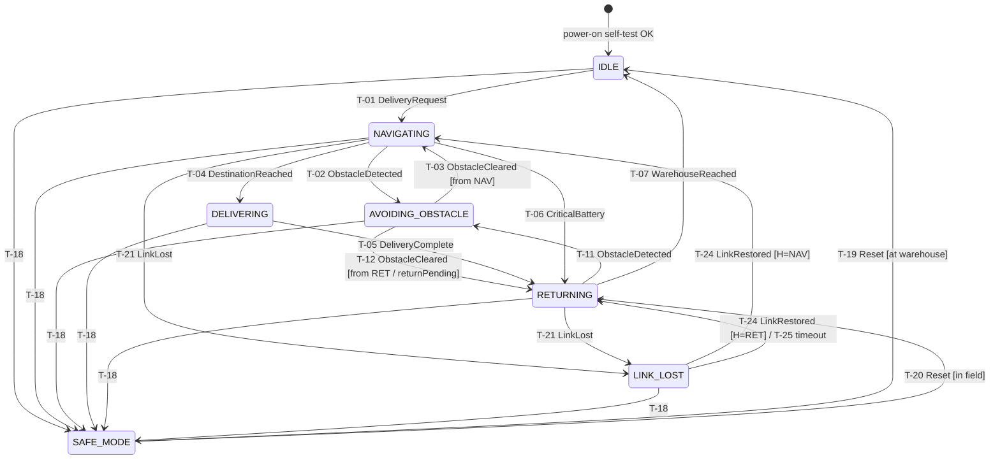

# Task 3 – State Modelling & Transition Verification (Delivery Robot)

## 3.1 States

| ID | State | Meaning | Entry condition | Exit condition |
|---|---|---|---|---|
| S-1 | IDLE | Robot is powered on at the warehouse, not moving, and waiting for a request. | Power-on self-test passed, **or** WarehouseReached from RETURNING, **or** Safe Mode reset at the warehouse. | A valid DeliveryRequest is accepted (FR-01), or a SafeModeTrigger occurs. |
| S-2 | NAVIGATING | Robot is moving toward the destination clinic and checking for obstacles and crossings. | DeliveryRequest accepted in IDLE, **or** ObstacleCleared in AVOIDING_OBSTACLE (when the robot came from NAVIGATING), **or** LinkRestored (history). | DestinationReached, ObstacleDetected, CriticalBattery, LinkLost or SafeModeTrigger. |
| S-3 | AVOIDING_OBSTACLE | Navigation is suspended. The robot stops or manoeuvres around the obstacle. | ObstacleDetected while NAVIGATING or RETURNING. | ObstacleCleared (back to the state it came from), or SafeModeTrigger. |
| S-4 | DELIVERING | Robot is stopped at the clinic. The chamber door is unlocked and the batch is handed over. | DestinationReached while NAVIGATING **and** the batch is not "at risk" (HR-03). | DeliveryComplete (handover is confirmed by the clinic), or SafeModeTrigger. |
| S-5 | RETURNING | Robot travels back to the warehouse, with or without a batch. | DeliveryComplete, **or** CriticalBattery during navigation, **or** Safe Mode reset in the field, **or** LinkLossTimeout. | WarehouseReached, ObstacleDetected, LinkLost or SafeModeTrigger. |
| S-6 | SAFE_MODE *(extension, CR-01)* | Motion is stopped and non-essential loads are shed. Only chamber conservation and the radio stay powered. The robot accepts no movement commands. | SafeModeTrigger from any operational state, within 3 s. | SafeModeReset by a **Supervisor** after the triggering condition has cleared. |
| S-7 | LINK_LOST *(extension)* | Robot is held at a safe stopping point (never inside a crossing). It keeps conserving the batch and buffers events. | LinkLost (30 s without a heartbeat) while NAVIGATING or RETURNING, or after finishing an avoidance or handover that was in progress. | LinkRestored, LinkLossTimeout or SafeModeTrigger. |

## 3.2 Events / Conditions

| ID | Event | Source | Description |
|---|---|---|---|
| E-01 | DeliveryRequest | Mission Control (Dispatcher) | A validated and authorised command to deliver batch *B* to clinic *K* |
| E-02 | ObstacleDetected | Lidar / ultrasonic | Object inside the safety envelope on the planned path |
| E-03 | ObstacleCleared | Lidar / planner | Path is free for 2 s in a row |
| E-04 | DestinationReached | GNSS / localisation | Robot is within 3 m of the clinic drop point |
| E-05 | DeliveryComplete | Clinic confirmation + door sensor | Handover is confirmed and the chamber door is closed and locked again |
| E-06 | WarehouseReached | Localisation | Robot is docked at the warehouse |
| E-07 | CriticalBattery | BMS | Battery ≤ 20 % (not enough charge to finish the trip safely) |
| E-08 | SafeModeTrigger | BMS / chamber / fault monitor | Battery ≤ 10 % (emergency), **or** battery/chamber temperature above the critical threshold, **or** a hardware fault |
| E-09 | LinkLost | Comms monitor | No heartbeat for 30 s |
| E-10 | LinkRestored | Comms monitor | 3 heartbeats in a row received |
| E-11 | SafeModeReset | Mission Control (Supervisor) | Authorised reset after the condition has cleared |
| E-12 | LinkLossTimeout | Onboard timer | 10 min spent in LINK_LOST |

**State vs. event.** A *state* is a condition the robot stays in for some time. While it is in a state its behaviour is stable: for example, in NAVIGATING it keeps driving and scanning. An *event* is an instant occurrence (a signal, a sensor reading crossing a threshold, a command) that has no duration. An event can *cause* a transition from one state to another. For example, "AVOIDING_OBSTACLE" is where the robot *is*. "ObstacleDetected" is what *happened* to put it there. The same event can have different effects in different states: ObstacleDetected in IDLE does nothing, but in NAVIGATING it suspends navigation.

## 3.3 State Transition Table (base model from the scenario)

"Valid?" values: **Yes** = allowed behaviour. **INVALID** = must never happen, and the implementation must reject it. **Added** = a transition the scenario text was missing, which I added after verification (see 3.5).

| T-ID | Current State | Event [guard] | Next State | Req. ID | Valid? | Verification evidence |
|---|---|---|---|---|---|---|
| T-01 | IDLE | E-01 DeliveryRequest [battery > 20 % ∧ chamber conserving ∧ operator authorised] | NAVIGATING | FR-01, FR-03 | Yes | TC-01: robot state = NAVIGATING in telemetry, log entry `DISPATCH_OK` |
| T-02 | NAVIGATING | E-02 ObstacleDetected | AVOIDING_OBSTACLE | FR-04, HR-04 | Yes | TC-05: stop command within 500 ms in the simulator trace |
| T-03 | AVOIDING_OBSTACLE | E-03 ObstacleCleared [came from NAVIGATING] | NAVIGATING | FR-04 | Yes | TC-05: navigation resumes, same route ID |
| T-04 | NAVIGATING | E-04 DestinationReached [batch not at risk] | DELIVERING | FR-01, HR-03 | Yes | TC-01 / TC-14 |
| T-05 | DELIVERING | E-05 DeliveryComplete | RETURNING | FR-01 | Yes | TC-01: log `HANDOVER_CONFIRMED`, door locked |
| T-06 | NAVIGATING | E-07 CriticalBattery | RETURNING | FR-05 | Yes | TC-06: log `DELIVERY_ABANDONED` with batch ID |
| T-07 | RETURNING | E-06 WarehouseReached | IDLE | FR-01 | Yes | TC-01 / TC-06 |
| T-08 | IDLE | E-04 DestinationReached (or a forced "Deliver" command) | DELIVERING | FR-01, FR-02 | **INVALID** | TC-04: command rejected `STATE_NOT_ALLOWED`, state stays IDLE |
| T-09 | AVOIDING_OBSTACLE | E-04 DestinationReached | DELIVERING | FR-04 | **INVALID** | TC-05: event ignored, state stays AVOIDING_OBSTACLE |
| T-10 | IDLE | E-02 ObstacleDetected | IDLE (no action) | FR-04 | Yes | TC-05 (robot not moving, so nothing to avoid) |
| T-11 | RETURNING | E-02 ObstacleDetected | AVOIDING_OBSTACLE | FR-04, HR-04 | **Added** | TC-05 variant on the return leg |
| T-12 | AVOIDING_OBSTACLE | E-03 ObstacleCleared [came from RETURNING ∨ returnPending] | RETURNING | FR-04, FR-05 | **Added** | TC-05, TC-06 |
| T-13 | AVOIDING_OBSTACLE | E-07 CriticalBattery | AVOIDING_OBSTACLE (sets `returnPending`) | FR-05 | **Added** | TC-06: after clearing, the robot goes to RETURNING, not NAVIGATING |
| T-14 | DELIVERING | E-07 CriticalBattery | DELIVERING (finish handover, then T-05) | FR-05 | **Added** | TC-06 variant |
| T-15 | IDLE | E-07 CriticalBattery | IDLE (DeliveryRequest blocked until charged) | FR-01 | **Added** | TC-04: request rejected `LOW_BATTERY` |
| T-16 | RETURNING | E-07 CriticalBattery | RETURNING (no change) | FR-05 | Yes | TC-06 |
| T-17 | NAVIGATING / AVOIDING_OBSTACLE / DELIVERING / RETURNING | E-01 DeliveryRequest | Same state, request rejected `ROBOT_BUSY` | FR-01, FR-02 | Yes | TC-04 |

### State diagram (base + extensions)

## 3.4 Extension: Safe Mode (CR-01) and Link Lost

**My decision on which states may enter them:**

- **SAFE_MODE can be entered from every operational state**, including IDLE and LINK_LOST. A thermal fault or an emergency battery level can happen at any time, even when the robot is parked with a loaded chamber. Safe Mode takes priority over every other event. Once in Safe Mode, only E-11 (Supervisor reset) can take the robot out.
- **LINK_LOST is entered only from moving states (NAVIGATING, RETURNING).** For the other states:
  - In AVOIDING_OBSTACLE the robot first finishes the avoidance, because stopping in the middle of a manoeuvre could leave it in a lane.
  - In DELIVERING the robot finishes the local handover, because the clinic confirmation is local and does not need the link.
  - In IDLE the robot is already parked, so it only gets flagged as *offline*.
  - The robot never stops *inside* a railway crossing. If the link drops while it is crossing, it completes the crossing first (see C-05 in Task 5).

| T-ID | Current State | Event [guard] | Next State | Req. ID | Valid? | Verification evidence |
|---|---|---|---|---|---|---|
| T-18 | IDLE, NAVIGATING, AVOIDING_OBSTACLE, DELIVERING, RETURNING, LINK_LOST | E-08 SafeModeTrigger | SAFE_MODE (within 3 s) | FR-06 (CR-01) | Yes | TC-07: timestamp(trigger) to timestamp(state = SAFE_MODE) ≤ 3 s, for each source state |
| T-19 | SAFE_MODE | E-11 SafeModeReset [condition cleared ∧ at warehouse ∧ role = Supervisor] | IDLE | FR-06, FR-03 | Yes | TC-07, TC-03 |
| T-20 | SAFE_MODE | E-11 SafeModeReset [condition cleared ∧ in field ∧ role = Supervisor] | RETURNING | FR-06, FR-03 | Yes | TC-07 |
| T-21 | NAVIGATING, RETURNING | E-09 LinkLost [not inside a crossing] | LINK_LOST (after reaching a safe stopping point) | HR-02 | Yes | TC-11 |
| T-22 | AVOIDING_OBSTACLE | E-09 LinkLost | AVOIDING_OBSTACLE, then LINK_LOST after E-03 | HR-02 | Yes | TC-11 variant |
| T-23 | DELIVERING | E-09 LinkLost | DELIVERING, then LINK_LOST after E-05 | HR-02 | Yes | TC-11 variant |
| T-24 | LINK_LOST | E-10 LinkRestored | History state (NAVIGATING or RETURNING) | HR-02, NFR-04 | Yes | TC-11: buffered events uploaded, no gaps |
| T-25 | LINK_LOST | E-12 LinkLossTimeout | RETURNING (autonomous) | HR-02 | Yes | TC-11 (shortened timer in simulation) |
| T-26 | SAFE_MODE | Any event except E-11 | SAFE_MODE | FR-06 | Yes | TC-07: DeliveryRequest rejected `SAFE_MODE_ACTIVE` |
| T-27 | IDLE | E-09 LinkLost | IDLE (flag offline) | HR-02 | Yes | TC-11 |
| T-28 | SAFE_MODE | E-11 SafeModeReset [role ≠ Supervisor ∨ condition still present] | SAFE_MODE (rejected) | FR-03, FR-06 | Yes | TC-03 |

## 3.5 Verifier Investigation

I didn't just check that each row of my table looked fine. I tried to break the model by looking for invalid, missing and unsafe transitions.

### (a) Can IDLE → DELIVERING happen? Which requirement is violated?

In the scenario model it *should not*, but **nothing in the narrative actually stops it**. If the localisation module raises DestinationReached while the robot is parked (for example, the warehouse is registered as a drop point, or a GPS glitch occurs), or if an operator sends a raw "Deliver" command, a naive implementation would open the chamber door in IDLE.

- **Violated:** the scenario rule "a waiting robot must never begin delivering directly", **FR-01** (delivery only through the dispatch → navigate path) and **FR-02** (a command not allowed in the current state must be rejected). It would also break constraint **C-08** (no door opening outside a confirmed handover).
- **Fix:** T-08 is explicitly INVALID. DELIVERING has exactly one way in, T-04 (from NAVIGATING). Mission Control rejects the command (`STATE_NOT_ALLOWED`) and the robot also ignores the event, so there are two layers of protection. Covered by **TC-04**.

### (b) What if AVOIDING_OBSTACLE has no transition back?

Then AVOIDING_OBSTACLE becomes a **trap (deadlock) state**. Once the robot meets its first obstacle it can never get back to NAVIGATING, so it can **never reach DELIVERING**. The delivery fails and the batch stays out of the warehouse with the chamber running down its battery. With only the T-18 extension it would sit there until Safe Mode triggered on emergency battery.

This is a **liveness** problem: "every accepted delivery eventually ends in DELIVERING or RETURNING" fails. A reachability check of the model finds it: DELIVERING is unreachable from any path that passes through AVOIDING_OBSTACLE. That is why T-03 and T-12 are required, and why I also recommend a **timeout**: if an obstacle stays for more than 5 min, raise an operator alert and allow re-routing.

### (c) Can AVOIDING_OBSTACLE → DELIVERING occur?

It **must not** (T-09 INVALID). The scenario explicitly says the robot must never deliver while handling an obstacle. The risk is real, because an obstacle can appear right at the clinic gate. The robot would then be inside the 3 m DestinationReached radius *while* in AVOIDING_OBSTACLE. If the delivery logic only checks position, it would unlock the door with an obstacle (maybe a person or vehicle) next to it.

**Fix:** DestinationReached is only acted on in NAVIGATING. The robot must first clear (T-03) and then re-evaluate the destination (T-04). Covered by **TC-05** step 4.

### (d) CriticalBattery while in AVOIDING_OBSTACLE or DELIVERING (missing transition)

The narrative only defines CriticalBattery for *navigation* (T-06). In AVOIDING_OBSTACLE and DELIVERING the behaviour is **undefined**. Depending on the implementation, the event could be dropped (the robot later carries on to the clinic with a 20 % battery and gets stranded) or could force an immediate RETURNING in the middle of a manoeuvre or handover. My decisions:

| Situation | Decision | Reason |
|---|---|---|
| AVOIDING_OBSTACLE + CriticalBattery | Stay and set `returnPending`. On ObstacleCleared go to **RETURNING**, not NAVIGATING (T-13, T-12). | You can't drive away through the obstacle. Remembering the event stops it from being lost. |
| DELIVERING + CriticalBattery | Finish the handover, then RETURNING (T-14 → T-05). | The robot is already stopped at the clinic. Handing the medicine over is safer than carrying it back. |
| Either state + **emergency** battery (≤ 10 %) | SAFE_MODE immediately (T-18). | CR-01 timing (≤ 3 s) applies, so it is not deferred. |

### Other problems I found

1. **Obstacles on the return trip are not handled.** The scenario only mentions checking for obstacles "while navigating", but RETURNING is also motion. I added T-11 and T-12. AVOIDING_OBSTACLE needs a history variable (came from NAV or RET), or the robot would resume driving to the clinic after an obstacle on the way home.
2. **DeliveryRequest while busy** was not specified. T-17 rejects it so that a second batch cannot be assigned in the middle of a trip.
3. **Unsafe Safe Mode exit.** Without the T-28 guard, any operator could reset Safe Mode while the battery is still at 8 %, and the robot would immediately trigger it again. A reset requires a Supervisor *and* a cleared condition.
4. **LINK_LOST inside a railway crossing** would be a fatal transition. T-21 is guarded with "not inside a crossing", linked to C-05.
5. **Two meanings of "critical battery".** The scenario uses one term, but CR-01 adds an "emergency level". I separated them: 20 % → RETURNING and 10 % → SAFE_MODE. Otherwise the robot could never return home, because it would always go into Safe Mode first.
