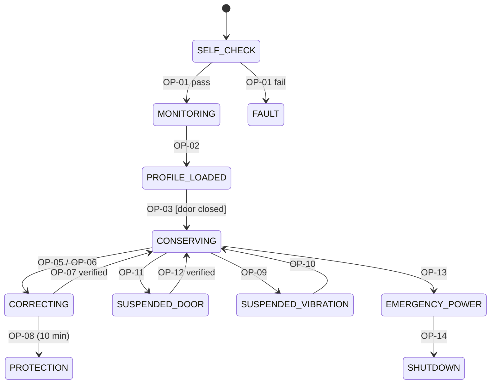

# Task 4 – Operation Identification & Operation Schema (Conservation Chamber)

## 4.1 Operations identified

I named these as *actions the system performs* (verb + object), not as states. For example, "Monitoring" is a state, while `ReadChamberSensors` is the operation performed in it.

| ID | Operation | Short description |
|---|---|---|
| OP-01 | RunSelfCheck | Test all essential sensors and actuators at power-on |
| OP-02 | LoadBatchProfile | Read the batch ID and its temperature/humidity limits into the chamber |
| OP-03 | StartConservation | Begin active conservation once the door is closed and the profile is loaded |
| OP-04 | ReadChamberSensors | Sample temperature, humidity, vibration, door and power every 1 s |
| OP-05 | CorrectTemperature | Drive the cooler/heater to bring temperature back into range |
| OP-06 | CorrectHumidity | Drive the humidifier/dehumidifier to bring humidity back into range |
| OP-07 | VerifyRecovery | Confirm from sensor readings that a corrected value has stayed in range for 60 s |
| OP-08 | ActivateProtection | Enter protection: reduce light exposure, mark the batch at risk, alert the operator |
| OP-09 | SuspendRiskyActivities | Pause risky actions (door unlock, compressor cycling, motion) on high vibration |
| OP-10 | ResumeAfterStabilisation | Resume once vibration stays below the threshold for 60 s |
| OP-11 | HandleDoorOpened | Suspend conservation when the door opens during conservation |
| OP-12 | VerifyConditionsAndResume | After the door closes, re-check sensors and limits before resuming |
| OP-13 | SwitchToEmergencyPower | Switch to the backup battery on main power loss |
| OP-14 | RecordIncidentAndShutDown | If there is no backup power, log the incident and shut down safely |
| OP-15 | AuthoriseBatchRemoval | Allow removal only when the chamber is safe and no protection is active |
| OP-16 | RaiseOperatorAlert | Send an alert to Mission Control (queued if the link is down) |

**Robot / Mission Control operations** (not part of the chamber, but I list them here so the RTM in Task 2 can reference them):

| ID | Operation | Short description |
|---|---|---|
| OP-R01 | AuthenticateOperator | Check operator credentials and create a session |
| OP-R02 | AuthoriseCommand | Check that the operator's role allows this command |
| OP-R03 | ValidateCommand | Check the format, robot ID and whether the command is allowed in the current state |
| OP-R04 | ExecuteRobotCommand | Send to the robot and apply the state transition |
| OP-R05 | ReportStatus | Send telemetry and the command result to Mission Control |
| OP-R06 | LogEvent | Append an entry to the event log |
| OP-R07 | EnterSafeMode | Stop motion, shed loads, keep chamber and radio powered |
| OP-R08 | RequestCrossingPermission | Query ARLCCS and decide whether to enter the crossing |
| OP-R09 | HandleObstacle | Stop and plan an avoidance |

## 4.2 Operation Schemas

### OP-01 RunSelfCheck

| Field | Value |
|---|---|
| Description | At power-on, test every essential sensor (2 temperature probes, humidity, vibration, door switch, power monitor) and the cooler/heater. |
| Inputs | Power-on signal |
| Outputs | Self-check result (PASS / FAIL + list of failed devices) |
| Reads | Raw sensor values, actuator feedback, sensor calibration dates |
| Changes | `chamberState` := CH-2 MONITORING (if PASS) or CH-0 FAULT (if FAIL); `sensorStatus[]` |
| Sends/Alerts | `SELF_CHECK_FAIL` alert + log entry if any essential device fails |
| Assumes (pre) | `chamberState = CH-1 SELF_CHECK`; power is available |
| Result (post) | `chamberState = MONITORING` **only if** every essential sensor gives a plausible value (within its physical range, and the two temperature probes differ by ≤ 0.5 °C); otherwise `FAULT` and no batch can be loaded |

### OP-02 LoadBatchProfile

| Field | Value |
|---|---|
| Description | Load the identity and storage limits of the medicine batch being placed in the chamber. |
| Inputs | Batch ID (scanned barcode/RFID), profile {Tmin, Tmax, RHmin, RHmax, maxVibration, lightSensitive} |
| Outputs | Profile-loaded confirmation |
| Reads | Batch registry (warehouse system), current chamber state |
| Changes | `activeProfile`, `batchId`, `chamberState` := CH-3 PROFILE_LOADED |
| Sends/Alerts | Log `PROFILE_LOADED(batchId)`; alert if the profile is missing or invalid (Tmin ≥ Tmax) |
| Assumes (pre) | `chamberState = MONITORING`; no other batch loaded; batch ID exists in the registry |
| Result (post) | `activeProfile` matches the registry entry for `batchId`; `chamberState = PROFILE_LOADED` |

### OP-03 StartConservation

| Field | Value |
|---|---|
| Description | Start active conservation of the loaded batch. |
| Inputs | Start request (automatic after door close + profile load) |
| Outputs | Conservation-started confirmation |
| Reads | `doorClosed`, `doorLocked`, `activeProfile`, sensor values |
| Changes | `chamberState` := CH-4 CONSERVING; control loop setpoints := profile midpoints |
| Sends/Alerts | Log `CONSERVATION_STARTED` |
| Assumes (pre) | `chamberState = PROFILE_LOADED` ∧ `doorClosed = TRUE` ∧ `doorLocked = TRUE` ∧ all essential sensors OK |
| Result (post) | `chamberState = CONSERVING`; control loop active. Robot T-01 (dispatch) is now allowed, because FR-01 requires the chamber to be conserving. |

### OP-05 CorrectTemperature

| Field | Value |
|---|---|
| Description | Bring an out-of-range temperature back into the profile range. |
| Inputs | Current temperature `T`, profile [Tmin, Tmax] |
| Outputs | Correction status (IN_PROGRESS / RECOVERED / FAILED) |
| Reads | Both temperature probes, cooler/heater feedback current, `correctionStartTime` |
| Changes | Cooler/heater duty cycle; `chamberState` := CH-5 CORRECTING; `correctionStartTime` |
| Sends/Alerts | Log `TEMP_EXCURSION(T)`; warning to the operator if not recovered within 5 min |
| Assumes (pre) | `chamberState = CONSERVING` ∧ (`T < Tmin` ∨ `T > Tmax`) |
| Result (post) | **Verified by sensors (OP-07):** `Tmin ≤ T ≤ Tmax` for 60 s in a row → `chamberState = CONSERVING`. If not achieved within 10 min → OP-08 ActivateProtection. |

### OP-08 ActivateProtection

| Field | Value |
|---|---|
| Description | Protect the batch when correction has failed. |
| Inputs | Correction FAILED signal (recovery period expired) |
| Outputs | Protection-active status |
| Reads | `batchId`, `activeProfile.lightSensitive`, excursion history |
| Changes | `chamberState` := CH-6 PROTECTION; internal light := OFF / minimum; `batchStatus` := AT_RISK; `protectionActive` := TRUE |
| Sends/Alerts | **High-priority alert** to the operator within 10 s (queued if LINK_LOST); log `PROTECTION_ACTIVATED`; if temperature is beyond the critical threshold, raise **E-08 SafeModeTrigger** to the robot |
| Assumes (pre) | `chamberState = CORRECTING` ∧ elapsed ≥ 10 min ∧ value still out of range |
| Result (post) | `protectionActive = TRUE` ∧ `batchStatus = AT_RISK`; batch removal and delivery blocked (OP-15, HR-03) until a Supervisor review |

### OP-11 HandleDoorOpened

| Field | Value |
|---|---|
| Description | React to the door opening while conservation is active. |
| Inputs | Door sensor change: closed → open |
| Outputs | Conservation-suspended status |
| Reads | `chamberState`, robot state, whether a handover is authorised |
| Changes | `chamberState` := CH-7 SUSPENDED_DOOR; `doorOpenTime` |
| Sends/Alerts | If the robot is **not** in DELIVERING or IDLE at the warehouse: tamper alert to the operator **and** stop request to the robot (constraint C-08); log `DOOR_OPENED` |
| Assumes (pre) | `chamberState ∈ {CONSERVING, CORRECTING}` ∧ `doorClosed` changes to FALSE |
| Result (post) | Normal conservation suspended; it can only resume through OP-12 (no automatic resume on door close) |

### OP-13 SwitchToEmergencyPower

| Field | Value |
|---|---|
| Description | Keep the chamber running when the main supply fails. |
| Inputs | Main-power-lost signal |
| Outputs | Power source status |
| Reads | Backup battery voltage and charge, bus voltage after switching |
| Changes | Power relay → backup; `powerSource` := EMERGENCY; `chamberState` := CH-8 EMERGENCY_POWER; non-essential loads shed |
| Sends/Alerts | Log `POWER_SWITCHED_EMERGENCY`; alert to the operator |
| Assumes (pre) | Main power lost ∧ `backupAvailable = TRUE` (charge > 10 %) |
| Result (post) | **Verified by sensors:** bus voltage within ±5 % of nominal within 500 ms **and** cooler running. If not verified → OP-14 RecordIncidentAndShutDown. |

### OP-15 AuthoriseBatchRemoval

| Field | Value |
|---|---|
| Description | Decide whether a batch may be taken out of the chamber. |
| Inputs | Removal request (clinic handover in DELIVERING, or warehouse unload) |
| Outputs | Removal ALLOWED / DENIED + reason |
| Reads | `protectionActive`, `batchStatus`, `chamberState`, vibration level, robot state |
| Changes | Door lock := UNLOCKED (if allowed); `batchId` := none after the door closes again |
| Sends/Alerts | Log `REMOVAL_ALLOWED` / `REMOVAL_DENIED(reason)` |
| Assumes (pre) | A batch is loaded ∧ the robot is stationary |
| Result (post) | Allowed **only if** `protectionActive = FALSE` ∧ `batchStatus ≠ AT_RISK` ∧ vibration < threshold ∧ (robot state = DELIVERING ∨ (IDLE ∧ at warehouse)) |

## 4.3 How operations change the chamber state (and link to Task 3)

Chamber states used: **CH-0** FAULT, **CH-1** SELF_CHECK, **CH-2** MONITORING, **CH-3** PROFILE_LOADED, **CH-4** CONSERVING, **CH-5** CORRECTING, **CH-6** PROTECTION, **CH-7** SUSPENDED_DOOR, **CH-8** EMERGENCY_POWER, **CH-9** SUSPENDED_VIBRATION, **CH-10** SHUTDOWN.

**Example 1 – Door opened during conservation (OP-11 → OP-12)**

| Step | Chamber | Robot (Task 3) |
|---|---|---|
| 1 | CH-4 CONSERVING, door closed | S-2 NAVIGATING |
| 2 | Door sensor reads OPEN → **OP-11 HandleDoorOpened** → CH-7 SUSPENDED_DOOR | Robot not in DELIVERING, so this is a tamper. Constraint C-08 is violated → robot stops, operator alert. If temperature then goes beyond critical → E-08 → **T-18 → S-6 SAFE_MODE** |
| 3 | Door closed → **OP-12 VerifyConditionsAndResume**: re-checks sensors, temperature and humidity in range for 60 s | Stays stopped until a Supervisor confirms |
| 4 | CH-4 CONSERVING | T-20 SafeModeReset → S-5 RETURNING (the batch is checked at the warehouse) |

The *legitimate* door opening is the handover. In S-4 DELIVERING, OP-15 unlocks the door → CH-7 SUSPENDED_DOOR. When the door is closed again, that is event **E-05 DeliveryComplete → T-05 → RETURNING**.

**Example 2 – Correction fails (OP-05 → OP-08)**

| Step | Chamber | Robot (Task 3) |
|---|---|---|
| 1 | CH-4, T = 5 °C | S-2 NAVIGATING |
| 2 | T = 9.2 °C → **OP-05 CorrectTemperature** → CH-5 CORRECTING | Unaffected, keeps navigating |
| 3 | After 10 min T is still 9.0 °C → **OP-08 ActivateProtection** → CH-6 PROTECTION, batch AT_RISK | Guard on **T-04** fails (batch at risk, HR-03): on arrival the robot cannot enter DELIVERING. The operator recalls it → RETURNING. |
| 4 | If T > critical threshold (e.g. 12 °C) | **E-08 → T-18 → SAFE_MODE** within 3 s (CR-01) |

## 4.4 Operations whose postcondition must be verified by sensors

1. **OP-05 CorrectTemperature (and OP-06 CorrectHumidity).** Issuing a command to the cooler does **not** mean the temperature has changed. The compressor may have failed, the door seal may be leaking, or the fan may be blocked. There is also thermal lag: the air sensor can read in range while the vials are still warm. If the postcondition were "assumed true" once the command was sent, the system would report the batch as safe while it was actually being damaged. That is the worst outcome for a vaccine cold chain, and it is also why protection mode (FR-08) exists. So the postcondition is "**sensor-confirmed** in range for 60 s in a row" (OP-07). Using two probes protects against one faulty sensor.

2. **OP-13 SwitchToEmergencyPower.** Switching the relay is only a *command*. The backup battery could be flat, the relay contacts could be welded or the fuse blown. If the system assumes power was restored, the chamber silently loses cooling and the incident is never recorded (OP-14 never runs). Reading the bus voltage and cooler current after the switch is the only way to know the postcondition actually holds.

*(The same idea applies to OP-12. After the door closes, the system must not just assume conditions are fine, which is why the scenario says operation "is not resumed until conditions and sensors are verified".)*
